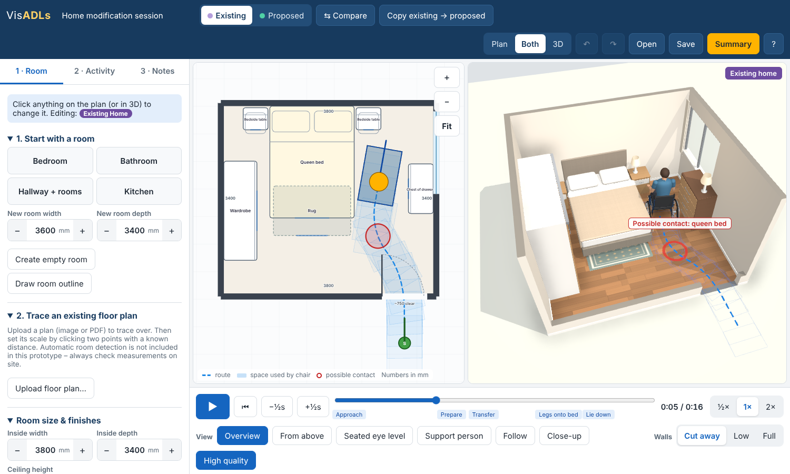
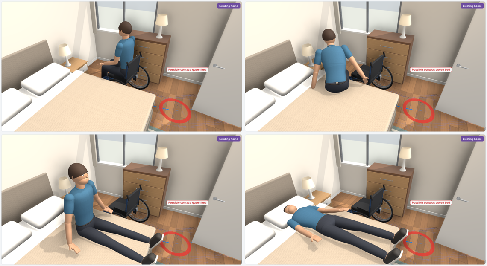

# VisADLs – Home Modification Explorer (web prototype)

A browser-based, interactive 3D tool that lets a person with spinal cord injury (SCI) and their
occupational therapist (OT) explore a home environment together, watch an activity of daily living
(ADL) being performed in it, try out modifications and compare the existing and proposed layouts.

This is **proof of concept #1** for the brief: a working, testable prototype, not a mock-up.





> ⚠️ Research prototype for discussion only. It is not a clinical assessment, does not check
> compliance with any standard, and the movements shown are illustrative placeholders until the
> authentic VisADLs motion-capture assets are imported.

---

## Run it

Requires Node.js 18+.

```bash
npm install
npm run dev        # opens on http://localhost:5173
npm run build      # static site in dist/ – can be hosted anywhere (GitHub Pages, intranet, shared drive)
```

Nothing needs installing on the OT's or consumer's computer – the built app is a static web page
that runs in Chrome, Edge, Safari or Firefox, including on recent tablets. Projects are autosaved in
the browser and can be saved/opened as `.visadls.json` files. Floor plans and models that are
imported stay on the local computer; nothing is uploaded.

## What the prototype does

| Brief requirement | In this prototype |
|---|---|
| Visually convincing room | Procedurally modelled bedroom, bathroom, hallway and kitchen with textured timber/tile floors, painted or tiled walls, skirting, door leaves, windows with frames and curtains, image-based lighting, soft shadows and ambient occlusion. |
| Recognisable furniture & equipment | ~23 parametric items (queen/single/care beds, bedside tables, wardrobe, drawers, toilet, wall basin, vanity, level-entry shower with hand shower & fold-down seat, grab rails, bath, shower commode, mobile hoist, kitchen bench, fridge, table…). Every dimension is editable in mm. |
| Human-like wheelchair user | Rigged, clothed procedural avatar (adjustable height, skin, hair and clothing) seated in a detailed manual (spoked 24" wheels, push rims, camber, castors) or powered (mid-wheel drive, joystick, headrest) wheelchair. Optional support person. |
| Basic movement sequence | Move around the room, bed transfer (approach → prepare → side transfer → legs onto bed → lie down), toilet transfer (reverse alongside → transfer), basin forward approach. Wheels roll, arms push the rims, the support person walks behind and moves in to assist. |
| Camera controls & playback | Play/pause, ½×/1×/2×, step ±½ s, timeline scrubbing with jump-to-phase chapters. Views: Overview, From above, **Seated eye level** (from the avatar's eyes), Support person, Follow, Close-up, plus free orbit/zoom (mouse or touch). Walls cut away automatically when viewing from above. |
| Intuitive environment editing | Linked 2D floor plan: drag furniture, walls (connected walls stretch), doors and windows; type exact mm values; wall items snap to walls; templates; draw a custom room outline; undo/redo; keyboard nudging. 3D updates immediately. |
| Compare changes | Separate **Existing** and **Proposed** layouts, “Copy existing → proposed”, and **Compare** mode showing both side by side with synchronised playback. |
| Functional detail | Door clear-opening estimates, live clearance dimensions from a selected item to the nearest wall/furniture, automatic wheelchair route with swept footprint (“space used by the chair”), red “possible contact” markers, chair parking outline, turning-space marker. Plain-language route summary with explicit caveats. |
| Floor plans | Upload an image or PDF, set its scale from a known distance, then let the app find walls, doors and windows automatically (with a review step), or trace them by hand. |
| Discussion & documentation | Notes tagged concern/preference/idea/question/decision, who raised it, optional pin on the plan, and the exact moment in the activity (click to jump back). Printable/downloadable session summary with 3D snapshots, layout facts, list of changes and notes. |
| Reuse existing assets | Import GLB/glTF or FBX models (furniture, equipment, MetaHumans). Animated files can drive the timeline as an “Imported animation” activity. |

## Feasibility assessment (short version)

**Feasible, with one important dependency.**

* **Environment editing, linked 2D/3D, comparison, notes, camera control, accessibility of the UI** –
  all achievable in the browser with Three.js and AI-assisted development. This prototype does
  that today.
* **Visual quality** – modern WebGL with physically based materials, image-based lighting,
  soft shadows and screen-space ambient occlusion gets close to a real-time Unreal scene of an
  interior, at a cost that ordinary laptops and recent iPads can handle (there is a “Fast mode”
  for slower devices). Furniture realism is limited mainly by model detail, which improves by
  importing purchased/CC0 models or exporting the originals from Unreal.
* **Human avatars and authentic movement** – *this is the dependency.* Procedural avatars like the
  one here are recognisable but not MetaHuman-quality, and hand-keyed transfers are illustrative,
  not authentic. Authentic quality requires the original motion-capture data (or new captures).
  The path for this is ready in the app (glTF import + timeline-driven animation), but the assets
  themselves must come from the original Unreal project (see below).
* **Automatic 3D generation from a floor plan** – a first version is included (see below). It works
  well on clean, orthogonal plans and always goes through a review step, because a drawing is not
  a measurement: door symbols and scaled lines can differ from what was actually built.

### Floor plan → 3D (automatic detection)

1. *Room → Use an existing floor plan → Upload floor plan…* (image or PDF).
2. *Set scale*: click two points a known distance apart (a dimension line, or a room whose size you
   know) and type the distance.
3. *Find walls automatically*, then drag a box around the floor to use (plans often show several).
4. Review the proposal over the drawing: walls (blue), doors (red), windows (teal), openings and
   double doors (orange). Choose *Use these walls*, *Try a different area* or *Discard*.
5. Fix anything wrong with the normal editing tools. The layout is flagged **“measurements not yet
   checked”** (on the plan, in the route summary) until someone confirms the key measurements.

How it works (`src/model/detect.ts`, runs entirely in the browser – the plan is not uploaded
anywhere). Plans draw walls in one of two ways, and the detector tries both and keeps the result that
looks most like a connected building:

* **Solid** (brochures, builders' plans): walls are the heaviest, darkest strokes, so it keeps dark
  pixels at least as thick as the plan's wall strokes.
* **Outline** (most CAD exports): walls are two thin parallel lines; wherever two long parallel lines
  are a wall-thickness apart (under ~340 mm) the space between them is filled in.

It then collects long horizontal/vertical runs, joins collinear pieces across doorway-sized gaps,
snaps ends together at corners and T-junctions, and discards isolated pieces (text, symbols). Each
gap is classified by what is drawn there: a swing arc or door leaves beside it = door; unbroken thin
parallel lines across it = window. Big images are read in tiles and shrunk to at most 3,400 px a side
(keeping thin lines visible), so a large plan never needs a huge amount of memory. The wheelchair
start point is put outside the exterior doorway from which the most floor area can be reached.

**Benchmark** – `npm run bench` scores the detector against 7 floors with ground-truth wall
positions from [MLSTRUCT-FP](https://github.com/MLSTRUCT/MLSTRUCT-FP) (MIT licence; plans 9,500 px
wide, including a colour CAD apartment plan with furniture and text):

| | precision | recall |
|---|---|---|
| Solid-walls detector only (first version) | 14% | 13% |
| Solid + outline detection (current) | **91%** | **84%** |

Precision is the share of detected wall length that lies on a real wall; recall is the share of real
wall length found. The dataset labels structural walls only, so on the detailed apartment plan real
partition walls count against precision. The Queenslander plan used during development (not
included, copyright unknown) gives the same result as before.

Known limits: orthogonal walls only (angled walls such as a bay or octagonal alfresco must be drawn
with *Draw room outline*); no reading of dimension text or room names yet; double/French doors
become openings; furniture is not detected. Planned improvements: reading vector PDFs directly
(exact geometry), reading dimension labels to set the scale automatically, and optional AI-assisted
recognition of doors, fixtures and room names (subject to consent for sending a plan to a cloud
service).

## Architecture

```
src/
  model/        Pure TypeScript – no rendering
    types.ts        Project / Layout / Item / Opening / Note (all plan units in millimetres)
    catalogue.ts    Furniture & equipment library with default sizes; wheelchair dimensions
    templates.ts    Bedroom, bathroom, hallway, kitchen, blank room
    geometry.ts     Plan maths (walls, rotations, polygon overlap)
    pathfinding.ts  Clearance-aware A* route on a 50 mm grid, smoothing, footprint contact check
    detect.ts       Wall/door/window detection from raster floor plans (solid and outline styles)
bench/            npm run bench: detection accuracy against ground-truth plans
    edit.ts         Wall moves, room resizing, existing→proposed difference list
    store.ts        App state (zustand), undo/redo, autosave
  activities/
    poses.ts        Joint-angle poses (seated, pushing, transfer, long-sit, lying, assisting, walking)
    activities.ts   Builds a timeline for each activity: chair track + person track + helper track
    useActivity.ts  Memoised per layout – recalculates when the room changes
  three/        3D rendering (React Three Fiber)
    Scene3D.tsx     Canvas, lights, cut-away walls, actors, route overlay, camera presets
    avatar.ts       Procedural rigged human
    wheelchair.ts   Manual and powered wheelchairs
    furniture.ts    Parametric furniture builders
    walls.ts        Walls with door/window openings, floor materials
    textures.ts     Procedural textures (works offline – no downloads)
    assets.ts       glTF/GLB/FBX import registry
  ui/           Plan editor (SVG), panels, timeline, summary
```

Key design decisions:

* **Millimetres everywhere in the data model.** The 3D scene converts to metres. Users never see
  coordinates, meshes or 3D terminology.
* **The 2D plan is the editing surface; 3D is for understanding.** Both render from the same data,
  so every change is reflected instantly.
* **Activities are data-driven timelines** (`time → chair pose, person pose, helper pose`). This makes
  scrubbing, pausing, compare mode and note time-stamps trivial, and the same interface is used for
  imported motion-capture clips (the mixer is set to the timeline time rather than free-running).
* **Activities adapt to the room.** The approach route is recalculated around the furniture
  every time something moves, and the transfer is positioned relative to the target bed/toilet.
* **No server.** Everything runs client-side; suitable for clinical settings with privacy concerns.

## Bringing in the original VisADLs assets

**The original Unreal project has been located** (Google Drive, *ADLS files / ADLs_Final*, Unreal
Engine 5.5) with all three scenes – P1Turn360, P2BedTransfer, P3Hallway. An export script that runs
inside Unreal is in [`tools/unreal/`](tools/unreal/README.md). The general steps below still apply.

When the original Unreal project (`.uproject` + `Content/`) is available:

1. **Avatars and wheelchairs.** In Unreal, select the MetaHuman / wheelchair skeletal meshes and
   *Export → FBX* (or use the glTF Exporter plugin). MetaHumans are heavy; use the lowest LOD that
   still looks right (LOD1–LOD3) and bake hair cards. Convert FBX → GLB in Blender (File → Import FBX,
   File → Export glTF 2.0, “Apply modifiers”, include animations) and optionally compress with
   `gltf-transform optimize` (Draco/Meshopt + KTX2 textures) to keep files small for tablets.
2. **Motion capture sequences (e.g. `P2BedTransfer`, `P3Hallway`).** These are typically Level
   Sequences driving skeletal animations. Export the person, the wheelchair and the support person
   *with their animation* (bake the sequence to the skeleton when exporting), ideally into one GLB so
   their synchronisation is preserved.
3. **Import** via *Room → Import 3D models*. If the file contains animation, the app offers to play
   it with the timeline (“Imported animation” activity). Position and rotate it like any furniture
   item so the movement happens in the right place in the room.

Licensing: check the current MetaHuman licence terms before using exported MetaHumans outside
Unreal (Epic historically required Unreal Engine rendering and relaxed this in 2025 to allow other
engines, but terms change, and research-ethics consent for the captured participants also applies).
If needed, the motion capture can be retargeted onto a different avatar (e.g. Character Creator,
MakeHuman) with the same skeleton. Assets extracted from the packaged build's `.pak/.ucas/.utoc`
files should not be relied on – the source project is the right route.

Next integration step (planned): retarget imported mocap clips onto the in-app avatar/wheelchair rig
so authentic sequences can be placed relative to *any* bed or toilet, the way the illustrative
sequences are now.

## Suggested next iterations

1. Usability session with 2–3 OTs and consumers; measure time to set up a room and comprehension.
2. Integrate the original assets (above) – the biggest single gain in visual and clinical authenticity.
3. Multi-room homes (room-to-room routes, door swings that block routes), ceiling hoist tracks,
   bathroom wet-area falls, kitchen reach ranges.
4. Personal equipment profiles (actual chair width/length/turning, footplate length, bed height).
5. Floor-plan detection: vector-PDF reading, dimension-label reading, angled walls, multi-floor.
6. Shared sessions (OT and consumer on different devices) and export to PDF report templates.

## Accessibility notes

Large hit targets (≥40 px), everyday labels (“Seated eye level”, “Space used by the wheelchair”),
keyboard operation (Space, arrows, R, Delete, Ctrl+Z/Y), visible focus outlines, touch pan/pinch
on the plan and orbit in 3D, colour is never the only signal (labels accompany red markers).
